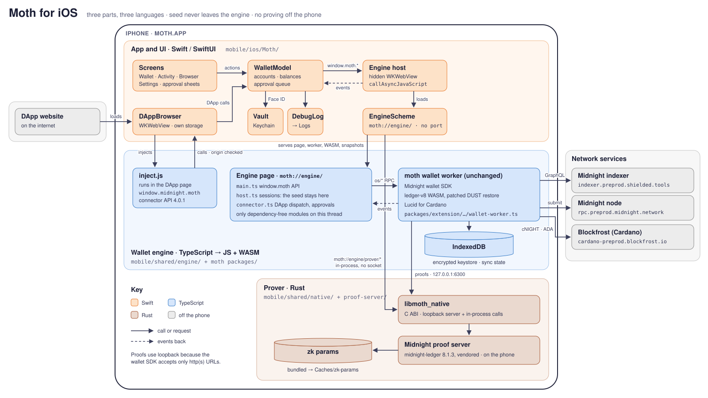
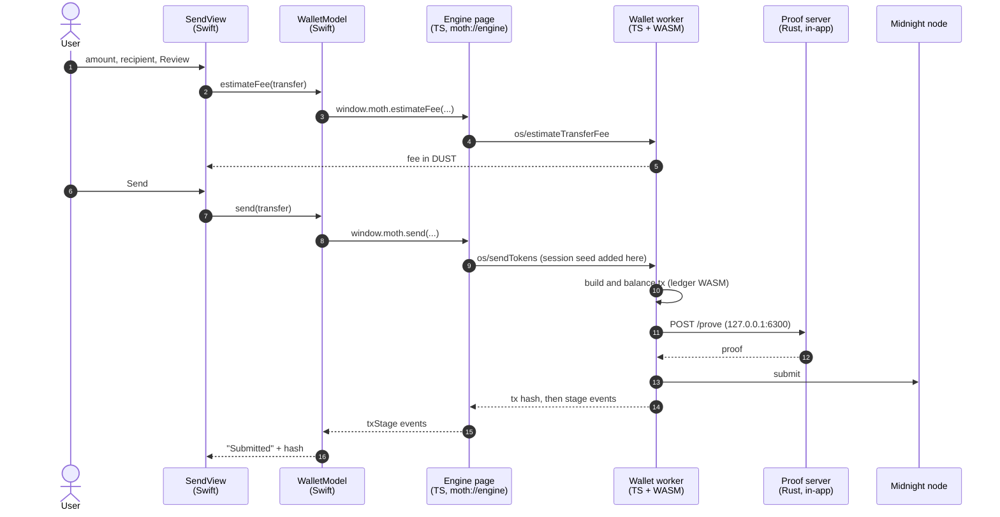
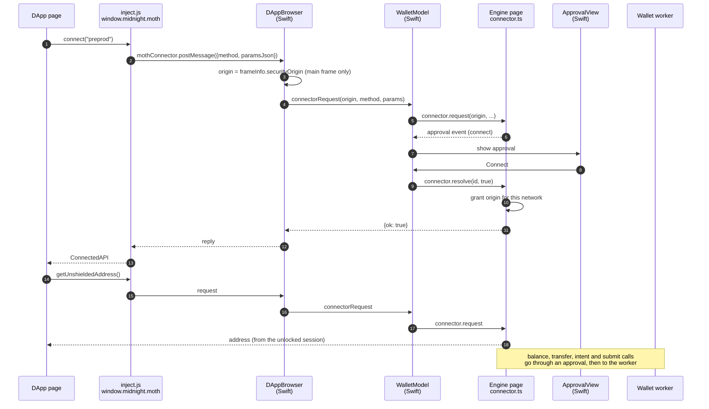
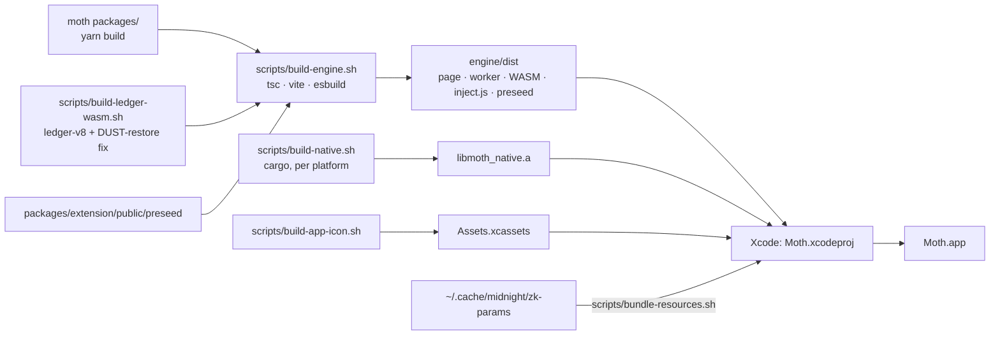

# Moth for iOS: how it's wired

Moth is three parts in three languages:

| Part | Language | Where | What it does |
|---|---|---|---|
| App and UI | Swift / SwiftUI | `mobile/ios/Moth/` | Every screen, the Keychain and Face ID handling, the DApp browser, the approval sheets |
| Wallet engine | TypeScript, run as JavaScript and WebAssembly | `mobile/ios/engine/` plus moth's `packages/` | moth's own wallet worker, unchanged: sync, balances, building transactions, the ledger. It runs inside a hidden WebView with no visible UI. |
| Prover | Rust | `mobile/ios/native/`, `mobile/ios/proof-server/` | Makes zero-knowledge proofs on the phone, compiled into the app |

## Components

Notes on the wiring:

- **The seed never reaches Swift.** Swift reads a random passphrase from the Keychain (Face ID or passcode) and hands it to the engine, which decrypts the keystore and keeps the seed in its session for as long as the wallet is unlocked. Locking, or sending the app to the background, drops it.
- **The engine page has no port.** `EngineScheme` serves it from the app bundle at `moth://engine/`. Its storage (IndexedDB) belongs to that origin, so the origin must never change without a migration.
- **Proofs use loopback for now.** The wallet SDK's prover client accepts only `http(s)` URLs, so the worker calls the in-app proof server at `127.0.0.1:6300`. The same endpoints are reachable in-process at `moth://engine/prover/*`; moving proofs there needs a fetch-based prover client in moth core.
- **DApps are isolated.** The browser uses its own website data store, so DApp pages can't reach the engine's storage. Each call's origin comes from WebKit's record of the frame, never from the page.

## A send

## A DApp call

## Build

